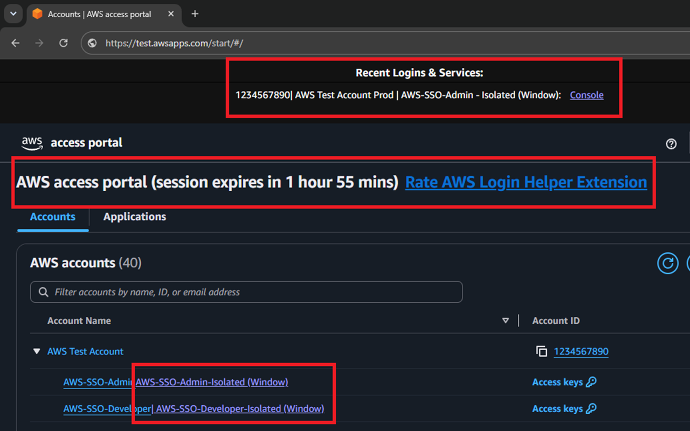

# AWS Login Helper (Edge)

Sign into AWS IAM Identity Center once, then open any account/role in its
own isolated Edge window - already signed in, no re-entering MFA per
account. A Microsoft Edge port of the original Firefox "AWS Login Helper"
extension, sitting alongside the `aws-login-helper-chrome` sibling folder in
this repo. Edge is Chromium-based, so the extension code is identical to the
Chrome build's; what differs is entirely plumbing (own registry hive, own
extension store, launches `msedge.exe` not `chrome.exe` - see
[development.md](development.md) for the full list). This is a fully
separate, parallel build - nothing is shared at runtime with
`aws-login-helper-chrome`, so both can be installed side by side without
conflict.

**We now support both Windows and macOS.** The companion app (the piece
that actually opens the isolated windows) is a native program: a per-user
`.msi` installer on Windows, and an `install.sh` tarball on macOS
(`native-host-mac/` + `package-mac/`; Apple Silicon and Intel). It does not
run on Linux. The extension itself will install fine on any OS Edge
supports, but without the companion app, clicking an account/role link will
not do anything.

> **Open source, nothing hidden.** The companion app's entire source is
> right here in this repo, under `native-host/` - there's no separate,
> closed-source binary being downloaded from anywhere else. All it does is
> launch a separate, dedicated Edge instance for each AWS account/role and
> copy your AWS SSO session cookie into it, so you don't have to sign in
> again. No telemetry, no data leaving your machine to anywhere other than
> AWS itself. Read the code yourself before you install it if you'd like:
> https://github.com/penchala-services-inc/aws-login-helper-edge

## Screenshots

The AWS access portal, with the "Isolated (Window)" links next to each
account/role and the Recent Logins & Services panel at the top:

An isolated console window, already signed in, with the account/role banner
pinned to the bottom:

The extension's options page - default console region, companion app
status, and the list of isolated profiles:

## Install

Two pieces, both required:

1. **Extension** - [Microsoft Edge Add-ons listing](https://microsoftedge.microsoft.com/addons/detail/aws-login-helper/fgkidhckfhjhahiechlealkomjlipjhl).
2. **Companion app**:
   - Windows - [download the installer](https://github.com/penchala-services-inc/aws-login-helper-edge/releases/latest)
     and run the `AWS-Login-Helper-Host-Edge.msi`. It installs per-user - no admin rights, no UAC prompt.
   - macOS - download the `aws-login-helper-host-edge-mac-osx-arm64.tar.gz` (Apple Silicon) or
     `...-osx-x64.tar.gz` (Intel) file from the same
     [release](https://github.com/penchala-services-inc/aws-login-helper-edge/releases/latest),
     extract it, and run `bash install.sh`. The app isn't signed by Apple, so macOS asks you to
     approve it a few times - the extension's welcome page walks through each step, and
     `package-mac/README.md` has the details.

The extension alone can't open isolated windows without the companion app
running, and the companion app already knows the published extension's ID
(baked into `extension-id.txt`/the installer's `EXTENSIONID` default - see
[development.md](development.md) only if you're testing an unpacked copy
instead).

> **The first click is slow - that's expected.** The very first account/role
> you open (after a reboot, or whenever the companion app's dedicated Edge
> instance isn't already running) has to cold-start that instance before the
> window can appear - typically a couple of seconds, longer on a machine
> where antivirus scans the companion app's `.exe` on that first launch.
> Every click after that, for the rest of the session, is fast.

## How it works

The extension watches the AWS access portal and adds an "Isolated (Window)"
link next to every account/role. Clicking one hands your current AWS SSO
session cookie to the companion app, which opens that account/role in its
own dedicated, isolated browser window - already signed in - and labels it
with a colored banner (account id, account name, role) so it's always clear
which account you're in. Opening a service by hand inside that window (e.g.
clicking into S3) gets reported back too, so it shows up under "Recent
Logins & Services" on the portal page next time you look.

For the full mechanics - why a second browser instance, how a click flows
end to end, how the banner gets injected - see [development.md](development.md).

## Other AWS Login Helper builds

- [Firefox (original)](https://github.com/penchala-services-inc/aws-login-helper-firefox) - uses Firefox containers instead of a companion app.
- [Chrome](https://github.com/penchala-services-inc/aws-login-helper-chrome) - the Google Chrome port, same approach as this one.

## Releases

See [releases.md](releases.md) for the version history.
